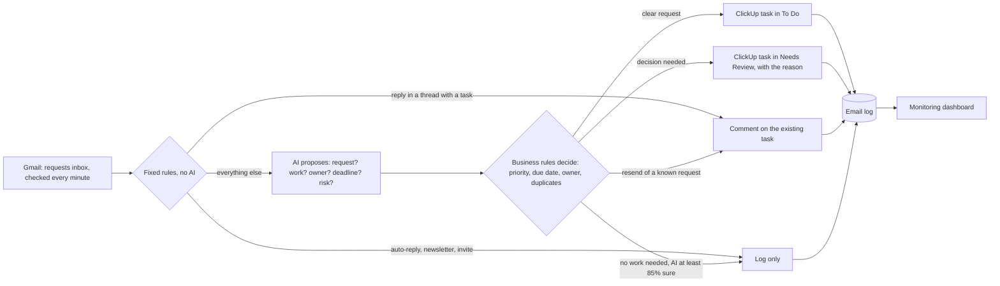

# Email to ClickUp Automation (n8n)

**From Inbox to Board:** a production-style n8n automation that turns work emails into ClickUp tasks with the right owner, priority and due date. A person is pulled in only when a real decision is needed.

> By Omar Qasem. Companion project: [product-availability-reply-agent-langgraph](https://github.com/omar-qasem/product-availability-reply-agent-langgraph), a LangGraph agent that answers product-availability comments.

**Live monitoring dashboard:** https://stately-puppy-1177c0.netlify.app/

---

## The problem and the answer

Requests arrive by email and get **missed, logged twice, or given the wrong urgency**. Should every email become a task automatically? **No.** Every email gets exactly one of four outcomes:

- Clear requests go straight to **To Do**.
- Replies and resends become **comments** on the task that already exists.
- Newsletters, thank-you notes and sales pitches are **only logged**.
- A person looks first (**Needs Review**) only when a decision is needed before work starts, and the task says what to decide.

## Highlights

| | |
| --- | --- |
| **Accuracy** | 20 new emails, written after the logic was final and run live against ClickUp: **20/20** right outcomes. Priority 8/8, category 10/10, owner 10/10, due date 8/8 |
| **Bilingual** | English, Arabic and mixed-language emails, including Arabic relative dates (`بكرا`) and the Sunday-to-Thursday work week |
| **The AI proposes, rules decide** | gpt-5-mini reads and proposes; fixed business rules make the final call on priority, dates, owner and outcome, so every decision is testable |
| **No duplicates** | Thread replies become comments with no AI call; resends are matched against the 25 most recent tasks (≥ 90% match); emails delivered twice are processed once |
| **Nothing lost silently** | One log line per email with its reason, alerts on every failure (deduplicated, emailed when critical), and a health check every 2 hours that compares the inbox with the log |
| **Cost and speed** | About 7 seconds and about $0.003 per email; emails caught by the fixed rules skip the AI entirely |
| **Tested like software** | 48 labeled emails (38 to build, 10 held back), a mock mode that writes to a table instead of ClickUp, and a self-score after every run |

## How it works

| Outcome | What happens |
| --- | --- |
| To Do | A ClickUp task with an owner, a priority and a due date |
| Needs Review | A task in the review list that says why it is there and what to decide |
| Comment | The reply or resend goes on the task that already exists |
| Log only | Newsletters, thanks and pitches are logged, with no task |

An email waits for a person when the ask is unclear, the deadline in it has already passed, it asks to pay, approve, sign or commit money (or is legal), it is a personal or HR matter, it may repeat an existing task, it asks different teams for different things, or the AI step failed or no owner is set. Failures raise alerts (workflow `02`), and a health check runs every 2 hours (workflow `03`).

The alternative considered, a custom agent in code with LangGraph, and the known gaps are covered in the [write-up](docs/From-Inbox-to-Board-Document.pdf).

## Repository layout

| Path | What it is |
| --- | --- |
| `workflows/01-email-intake-clickup.json` | Main workflow: email to ClickUp |
| `workflows/02-alerts.json` | Failure alerts |
| `workflows/03-health-check.json` | Health check, every 2 hours |
| `data/intake_routing_rules.csv` | Owner for each type of work |
| `data/intake_sample_emails.csv` | The 30 held-back and new labeled test emails |
| `docs/From-Inbox-to-Board-Document.pdf` | The write-up |
| `docs/From-Inbox-to-Board-Slides.pptx` | The slides, with speaker notes |

The workflow files contain no keys: credentials are referenced by name and connected in n8n.

## Setup

### 1. Put the workflows in n8n

Do this for `02-alerts.json`, then `03-health-check.json`, then `01-email-intake-clickup.json`:

1. Open the file in a text editor, select all and copy.
2. In n8n, click **Create Workflow**.
3. Click the empty canvas and paste (Ctrl+V, or Cmd+V on a Mac).
4. Click **Save**.

Or, in step 3: `⋯` menu → **Import from File** → pick the file.

### 2. Connect

1. **Data tables:** Overview → Data tables → create the six tables listed at the end. For `intake_routing_rules` and `intake_sample_emails`, use **Import CSV** with the two files in `data/`.
2. In every **Data table** node, pick its table from the list.
3. **Credentials:**
   - Gmail OAuth2 (the requests inbox) → Gmail: new email in requests inbox, Gmail: recent inbox emails, Email the alert
   - ClickUp OAuth2 → the 3 ClickUp nodes
   - OpenAI API key → OpenAI model node (not needed on n8n Cloud, which uses n8n AI credits)
   - Header Auth (the dashboard key) → the 4 "Send … to dashboard" nodes
4. **Link to Alerts:** in workflows 01 and 03, `⋯` menu → Settings → Error workflow → **Email Intake → Alerts**. Pick the same workflow in the nodes **Report failure to Alerts** (01) and **Raise alert** (03).
5. **Settings** node (01): enter your ClickUp IDs in `cfg_team_id`, `cfg_space_id`, `cfg_requests_list_id` (To Do list) and `cfg_triage_list_id` (Needs Review list). `cfg_mode`: `live` = real ClickUp, `mock` = test table.
6. **Alert settings** (02): `cfg_alert_email` = who receives critical alerts, `cfg_n8n_url` = your n8n address.
7. **Health settings** (03): `n8n_url` = your n8n address.
8. Publish 02, then 03, then 01.

### 3. Run

- **Live:** send an email to the connected inbox. It reaches ClickUp in about a minute.
- **Demo:** in workflow 01, run the trigger **Run demo with sample emails**. Each run takes up to 16 test emails that are not in the log yet, oldest first.

## How the dashboard is connected

1. Each workflow's settings node holds the dashboard address in `cfg_monitor_url`: `https://stately-puppy-1177c0.netlify.app/api/ingest`.
2. Four HTTP Request nodes send a POST with JSON `{ "type": …, "data": … }` to that address:

| Node | Workflow | `type` | When |
| --- | --- | --- | --- |
| Send email to dashboard | 01 | `email` | After each email is logged |
| Send run to dashboard | 01 | `run` | After each run, with the run summary and accuracy |
| Send alert to dashboard | 02 | `alert` | On every alert |
| Send health to dashboard | 03 | `health` | Every 2 hours, as a heartbeat |

3. Each request carries a secret key in a header (the n8n **Header Auth** credential). Requests without the key are refused (401).
4. The dashboard shows Overview, Emails, Alerts, Runs, Health and Test runs. The email log in n8n stays the source of truth.
5. If the dashboard is down, the workflows carry on. Leave `cfg_monitor_url` empty to switch it off.

## Data table columns

Text unless a type is shown.

- `intake_email_log` (one row per email): message_id, thread_id, received_at, from_email, subject, title, lane, reason, request_type, category, priority, confidence (number), owner, due_date, language, task_id, task_url, ai_ok (boolean), mode, source, sample_id, execution_id, processed_at, action_ok (boolean), flags, from_name, sender_kind, client_name, list_name, review_reasons, tags, due_source, error_node, error_message, summary, clarifying_question, ai_rationale, target_task_id, latency_sec (number)
- `intake_task_map` (email thread → ClickUp task): thread_id, message_id, task_id, task_url, list_name, title, subject, requester_email, client_name, category, lane, created_at
- `intake_routing_rules` (owner per category): category, owner_name, owner_role, owner_email, clickup_user_id, notes
- `intake_sample_emails` (test emails): sample_id, message_id, thread_id, in_reply_to, from_name, from_email, to_email, cc, subject, body, received_at, auto_submitted, list_unsubscribe, lang, split, exp_lane, acceptable_lanes, exp_is_request (boolean), exp_type, exp_priority, exp_category, exp_owner, exp_due, notes
- `intake_mock_clickup` (mock mode output): mock_task_id, message_id, lane, list_name, title, status, priority, due_date, owner, tags, target_task_id, description, created_at
- `intake_alerts` (one row per alert): alert_id, created_at, severity, type, title, message, details, hint, workflow_name, workflow_id, node, execution_id, execution_url, message_id, subject, mode, dedupe_key, emailed (boolean)
